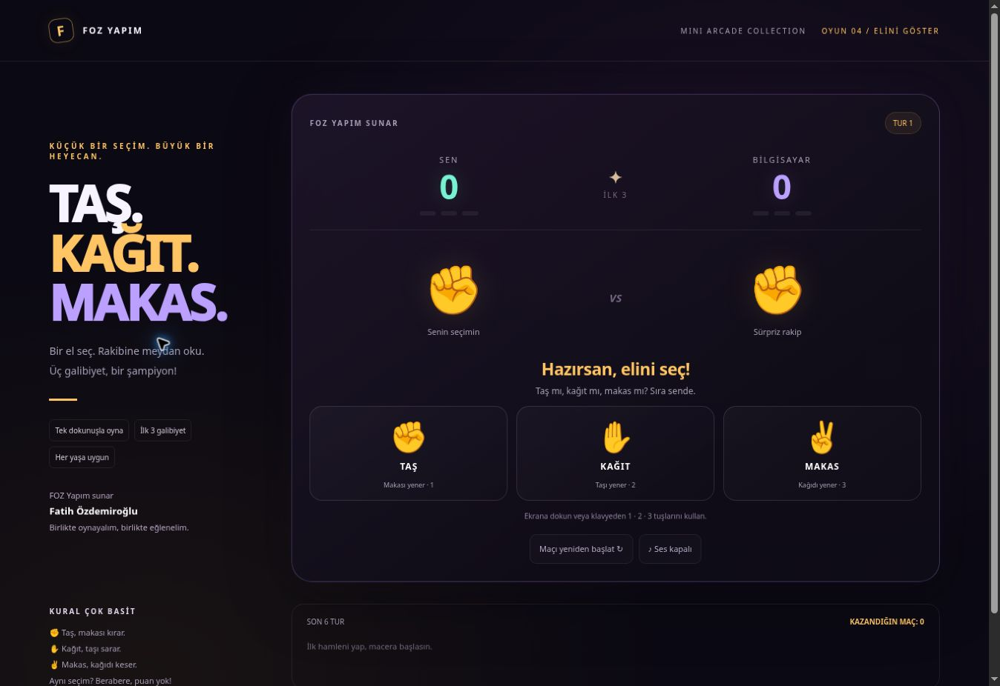

# Taş Kağıt Makas — FOZ Yapım

## [▶ TARAYICIDA OYNA](https://fozdemiroglu.github.io/tas-kagit-makas/)

**Oynamak için yukarıdaki bağlantıya tıkla.** İndirme, kurulum veya GitHub hesabı gerekmez.

FOZ Yapım sunar · **Fatih Özdemiroğlu**

Bilgisayara karşı veya aynı cihazda iki kişiyle neon taş–kağıt–makas. İlk **3 galibiyete** ulaşan maçı kazanır; beraberlikler puan getirmez.

- Büyük ✊ ✋ ✌️ düğmeleri; dokunmatik ve klavye desteği.
- Taş… Kağıt… Makas! animasyonu, skor tabelası ve kazanınca konfeti.
- Son altı tur, kazanılan maç sayısı ve isteğe bağlı ses.
- Telefon ve bilgisayara uyumlu ekran; azaltılmış hareket tercihine destek.

## İki kişilik oyun

Üstteki **👥 2 kişi** seçeneğine bas. **1. oyuncu** seçim yapar; seçim gizlenir ve cihazı devretme ekranı açılır. Ekranı diğer oyuncuya ver; **2. oyuncu hazır** düğmesine basıp ikinci seçimi yap. İki el animasyon sonunda birlikte açılır. İlk üç galibiyete ulaşan kazanır.

Seçim yapılırken diğer oyuncu ekrana bakmamalıdır. Her iki oyuncu aynı cihazı sırayla kullanır. Mod değişikliği veya yeniden başlatma mevcut maçı sıfırlar. İki kişilik maçlar bilgisayara karşı kazanılan maç sayacını değiştirmez.

## Kontroller

Düğmelere dokun veya **1: Taş · 2: Kağıt · 3: Makas** tuşlarını kullan. Yeni maç için **Yeni maç oyna**; mevcut maçı sıfırlamak için **Maçı yeniden başlat** düğmesine bas.

Kazanılan maç sayısı yalnızca kullandığın tarayıcıda saklanır. Ses başlangıçta kapalıdır. Bilgisayar her tur rastgele ve oyuncunun seçiminden bağımsız seçim yapar.

## Yeni: XOX & SOS

**[▶ XOX & SOS OYNA](https://fozdemiroglu.github.io/tas-kagit-makas/xox-sos/)** — Bilgisayara karşı veya 2 kişi, iki strateji oyunu. [Açıklamalar ve kaynak kodları](xox-sos/).

## Diğer FOZ Yapım oyunları

- [▶ Shadow Runner](https://fozdemiroglu.github.io/shadow-runner/)
- [▶ Neon Drift](https://fozdemiroglu.github.io/neon-drift/)
- [▶ Neon Tower](https://fozdemiroglu.github.io/neon-tower/)
